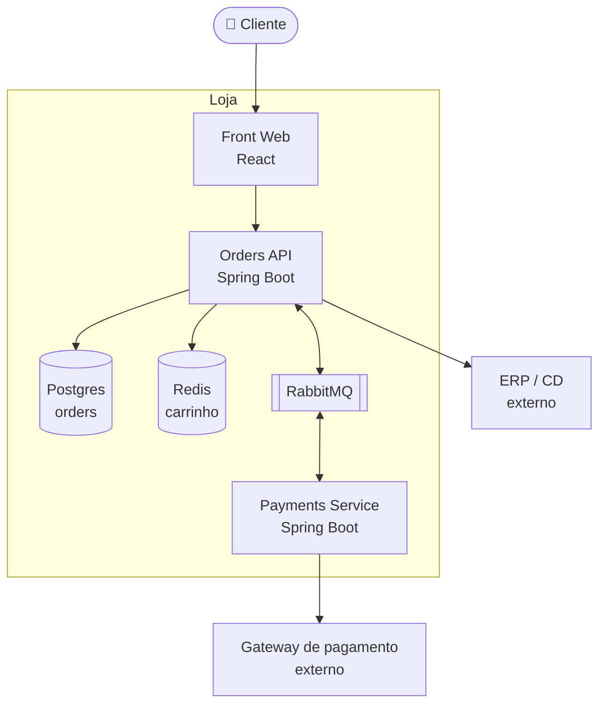

# 🏗️ Visão geral — nível Container (C4)

## Notas
- Orders e Payments têm bancos **separados**; não existe join entre pedido e pagamento. Consultas combinadas passam pela API.
- Integração com ERP é via arquivo CSV em SFTP a cada 15 min (!!). Sim, é real.
