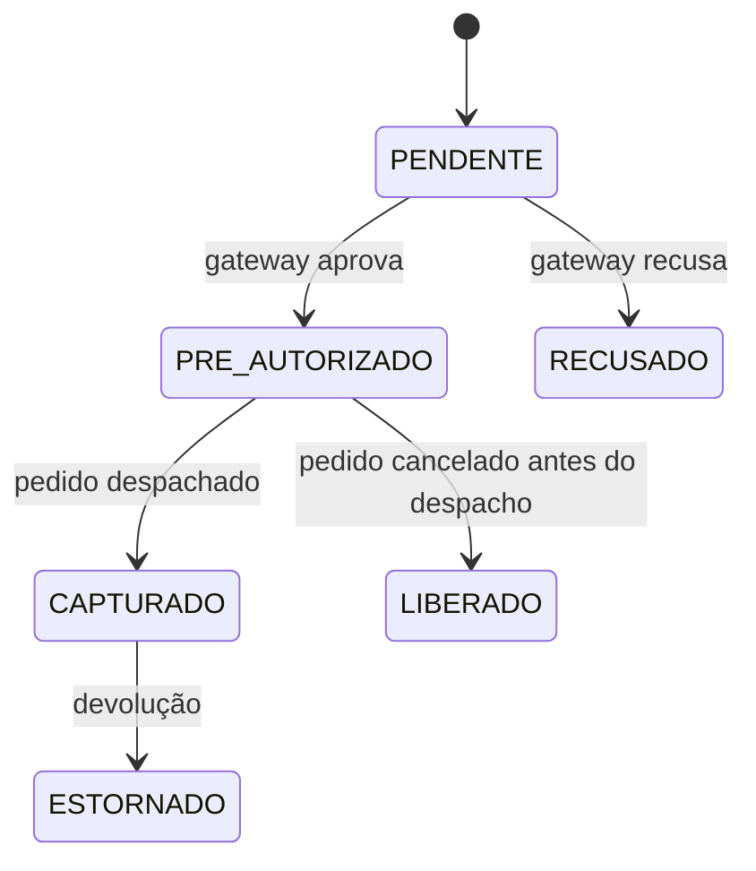

# 🧱 Pagamento

**Em uma frase:** a cobrança de um [[Pedido]], feita em duas etapas (pré-autorização → captura).
**Código:** `payments/` (serviço separado!) · integra com gateway externo
**Por que é assíncrono:** [[ADR-001 Pagamento assíncrono via fila]]

## Ciclo de vida

## Pegadinhas
- Pix não tem pré-autorização: vai direto para `CAPTURADO`. Cancelar Pix = sempre estorno. #confirmado
- Webhook do gateway pode chegar **duplicado**; o handler é idempotente pelo `gateway_transaction_id`.
