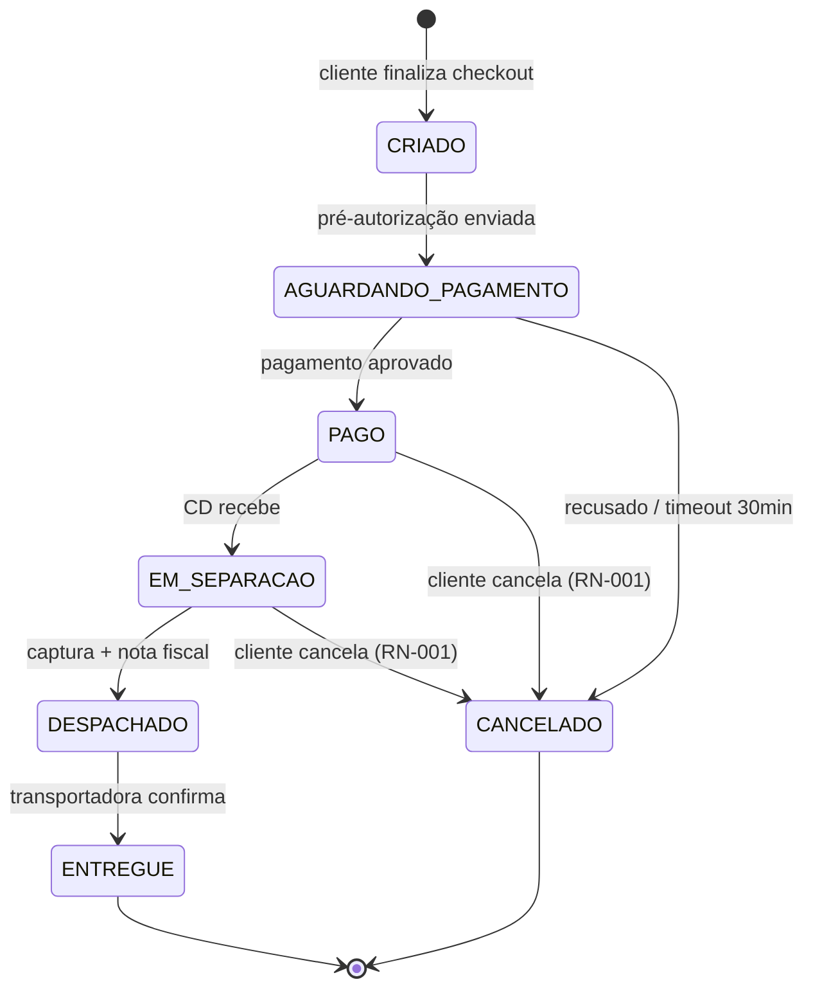

# 🧱 Pedido

**Em uma frase:** a intenção de compra do cliente, do checkout até a entrega.
**Código:** `orders/domain/Order.java` · tabela `orders`
**Dono no negócio:** [[Ana Lima|Ana (PO)]]

## Ciclo de vida

## Regras que afetam
- [[RN-001 Cancelamento de pedido]]
- [[RN-002 Frete grátis]]

## Relações
- Pertence a um [[Cliente]]
- Tem um [[Pagamento]] (1:1 hoje, mas ver [[Dúvidas em aberto]])

## Pegadinhas que já descobri
- O status no banco é em inglês (`AWAITING_PAYMENT`), na tela aparece em português. Mapeamento em `OrderStatusLabel`.
- Pedido nunca é deletado, só cancelado (auditoria fiscal). #confirmado
