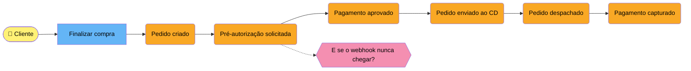
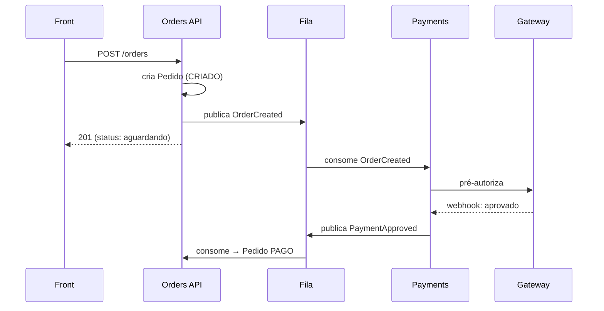

# 🔄 Fluxo — Checkout

## Quadro de Event Storming (Excalidraw)
> Versão "quadro branco" para pensar e reorganizar. Clique para abrir e editar.

![[Event Storming - Checkout.excalidraw]]

## Linha do tempo de eventos (estilo Event Storming)
> Laranja = evento · Azul = comando · Amarelo = ator · Rosa = problema/dúvida

## Sequência técnica

## Respostas
- Webhook que nunca chega: há um job que expira pedidos em `AGUARDANDO_PAGAMENTO` após 30 min. Ver [[Pedido]].
